# Forzy — Monitoramento de Ativos Industriais

## Challenge Sprint 4 · Documentação Final do Projeto

**Disciplina:** Front End & Mobile Development

**Professor:** Lucas Tadeu Cunha Rios

**Repositório:** [https://github.com/guilhermegamabs/py-challenge-sprint-4-front-end](https://github.com/guilhermegamabs/py-challenge-sprint-4-front-end)

| Integrante | RM |
|---|---|
| Guilherme Gama | RM565293 |
| Bruno Fernandes Nascimento | RM552574 |
| Edgar Lódula de Assis | RM565260 |
| Júlia Aben-Athar | RM566325 |
| Igor Thiago Nakajima Vieira | RM563632 |

---

## 1. Introdução

A Forzy precisa que o operador de manutenção saiba **qual motor está degradando, por que, e o que fazer** — antes da parada. Nas Sprints 1 a 3 o grupo construiu, em Streamlit, a interface que responde a isso:

| Sprint | Entrega |
|---|---|
| 1 | Cadastro técnico do ativo, consulta com filtros, dados brutos com conversão ADC → unidades de engenharia |
| 2 | SQLite, navegação Planta → Área → Ativo, dashboard com gauges e série temporal, OCR da placa via Gemini |
| 3 | Painel de Alertas e Estados como página inicial, 3 detectores de anomalia, resumos em linguagem natural, apoio à decisão, atualização automática |

A Sprint 4 não traz funcionalidade nova. Este documento registra **o que mudou desde a entrega da Sprint 3**, os diferenciais e resultados da solução, o que ficou pendente e por quê, e uma proposta de evolução para arquitetura de produção.

O repositório da Sprint 4 foi criado **a partir do histórico da Sprint 3**: os commits anteriores estão preservados e cada mudança desta sprint é um commit isolado sobre a entrega da Sprint 3. É por eles que a comparação pode ser conferida no GitHub.

---

## 2. Evolução desde a Sprint 3

### 2.1 Ponto de partida — o que a Sprint 3 entregou

Sete telas, organizadas em três grupos na sidebar:

| Tela | Estado na Sprint 3 |
|---|---|
| Painel de Alertas e Estados | KPIs da frota, resumo executivo por IA, cards de alerta, 3 recomendações priorizadas, histórico filtrável, timer de 5 s a 1 min |
| Navegação por Planta | Cards por área com status colorido e mini-leituras |
| Dashboard do Ativo | 4 gauges com faixas warn/crit, série temporal com bandas, alertas do período |
| Consulta / Novo Equipamento / Módulo Técnico / Dados Brutos | CRUD com OCR da placa e conversão ADC |

Camada analítica: resíduo de previsão, CUSUM e variância de janela (`app/services/analitico.py`); resumos pelo Gemini 2.5 Flash com fallback por template (`resumos.py`); ingestão do motor real `MOTOR-220V-01` a partir do Parquet da camada Silver.

**Dívidas que a entrega carregava**, levantadas na revisão de código no início desta sprint:

| # | Problema | Onde |
|---|---|---|
| D1 | Texto vindo do OCR, do cadastro e da LLM era interpolado cru em HTML renderizado com `unsafe_allow_html=True` | `cards_alerta.py`, `estilos.py` |
| D2 | Nenhum teste automatizado | — |
| D3 | `requirements.txt` sem versões | raiz |
| D4 | Arquivos `.pyc` versionados desde a Sprint 1, apontando para módulos que já não existem | `app/__pycache__/` |
| D5 | Toda a lógica acessível só pela interface Streamlit — nenhum outro cliente consegue consumir | arquitetura |

### 2.2 O que foi adicionado, alterado ou corrigido

| Tipo | Mudança | Resolve |
|---|---|---|
| qualidade | Remove `.pyc` do versionamento | D4 |
| correção | Helper `esc()` e escape em todos os componentes que recebem texto externo | D1 |
| qualidade | Versões fixadas em `requirements.txt` | D3 |
| qualidade | 22 testes automatizados (`pytest`) | D2 |
| arquitetura | Protótipo de API REST em FastAPI sobre a mesma camada de serviços | D5 (seção 5) |
| interface | Rótulo da sidebar atualizado para a Sprint 4 | — |
| correção | Erros do próprio framework também saem no formato padrão em português | achado nesta sprint |
| correção | Mensagem legível quando o corpo da requisição não é JSON | achado nesta sprint |

Nenhuma tela foi removida nem teve comportamento alterado para o operador, além da correção de exibição do item D1.

### 2.3 Comparativos antes / depois

#### a) Texto externo virando HTML (D1)

Para provar o problema foi cadastrado o equipamento `EQ-XSS` com Modelo `<i>Teste</i>` e Fabricante `<b style="color:red">WEG</b>` — o tipo de texto que um OCR mal lido ou uma resposta inesperada da LLM pode produzir.

**Antes — Sprint 3.** O navegador interpreta o texto como marcação: "Teste" em itálico e "WEG" em vermelho. Um texto com `` executaria script.

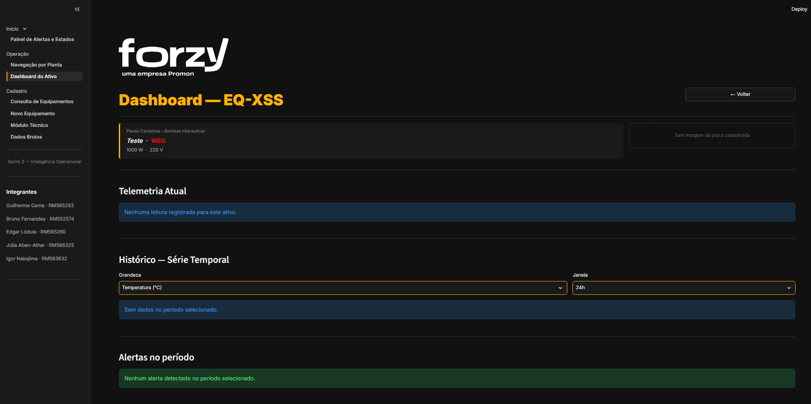

**Depois — Sprint 4.** O mesmo registro aparece como texto literal.

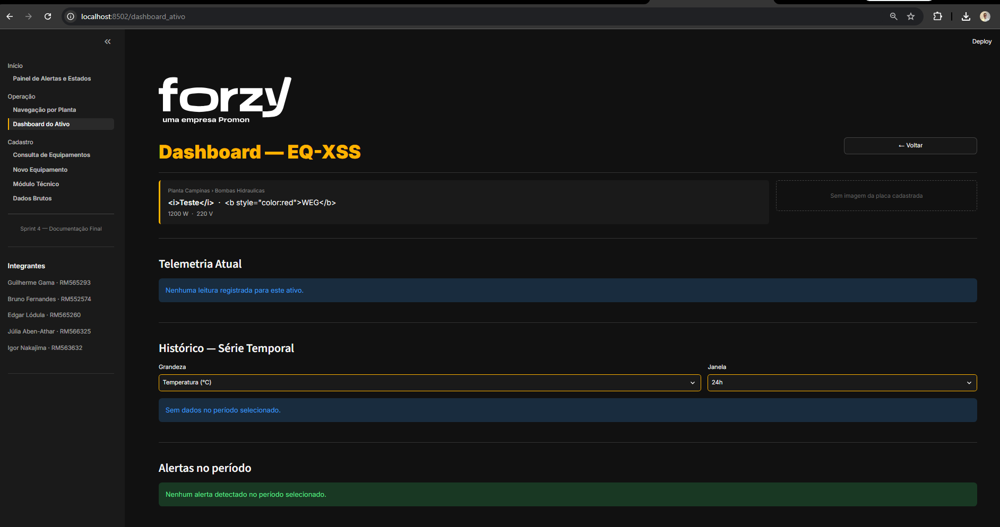

A correção é um helper único, aplicado em todos os builders que recebem dado de fora:

```python
# app/components/estilos.py
def esc(valor) -> str:
    """Escapa texto antes de interpolar em HTML renderizado com unsafe_allow_html.

    TAG, modelo e fabricante chegam do OCR e do cadastro manual; título e resumo
    chegam da LLM. Um `<` em qualquer um deles quebrava o card ou injetava markup.
    """
    return "" if valor is None else html.escape(str(valor))
```

```diff
# app/components/cards_alerta.py — html_card_alerta()
-        f'<strong style="color:{CORES["primary"]}; font-size:1.05rem;">{tag}</strong>'
+        f'<strong style="color:{CORES["primary"]}; font-size:1.05rem;">{esc(tag)}</strong>'
-        f' margin-top:10px;">{titulo}</div>'
+        f' margin-top:10px;">{esc(titulo)}</div>'
-        f' margin-top:6px;">{resumo}</div>'
+        f' margin-top:6px;">{esc(resumo)}</div>'
```

Pontos cobertos: card de alerta (TAG, título, resumo, causa, unidade, local), card de recomendação, resumo executivo, card de equipamento da Navegação por Planta, cabeçalho do Dashboard e as linhas ✓/⚠ do OCR no cadastro.

#### b) Testes automatizados (D2)

| | Sprint 3 | Sprint 4 |
|---|---|---|
| Testes | 0 | **22**, todos passando em ~2 s |
| Detectores | validados só visualmente na demo | cada modo de falha tem um teste que exige o detector certo |

Os testes da camada analítica não dependem do banco: uma série sintética substitui `get_historico` e cada modo de falha da demonstração é injetado nela.

```python
def test_deriva_termica_lenta_dispara_cusum(monkeypatch):
    df = _serie()
    inicio = int(N * 0.75)
    df.loc[inicio:, "temperatura"] += np.linspace(0, 4.0, N - inicio)
    diag = _avaliar(monkeypatch, df)
    assert diag.detectores["cusum"]
    assert diag.alarme


def test_sensor_congelado_dispara_variancia(monkeypatch):
    df = _serie()
    for g in BASE:
        df.loc[N - 30 :, g] = df.loc[N - 31, g]
    diag = _avaliar(monkeypatch, df)
    assert diag.detectores["variancia"]
    assert diag.pista == analitico.PISTA_INSTRUMENTACAO
```

| Arquivo | O que garante |
|---|---|
| `tests/test_analitico.py` (10) | Operação normal não dispara; spike → resíduo; deriva → CUSUM; sensor congelado → variância; regras de severidade; CUSUM acumula viés e ignora ruído |
| `tests/test_componentes.py` (4) | Nenhum componente deixa `` virar markup |
| `tests/test_api.py` (8) | API Key, propagação do `trace_id`, erros em português, feedback de IA — rodando contra SQLite temporário |

Saída de `pytest -v` na Sprint 4:

```text
tests/test_analitico.py::test_operacao_normal_nao_dispara PASSED
tests/test_analitico.py::test_spike_de_vibracao_dispara_residuo PASSED
tests/test_analitico.py::test_deriva_termica_lenta_dispara_cusum PASSED
tests/test_analitico.py::test_sensor_congelado_dispara_variancia PASSED
tests/test_analitico.py::test_sem_historico_devolve_none PASSED
tests/test_analitico.py::test_severidade[...] PASSED            (4 casos)
tests/test_analitico.py::test_cusum_acumula_vies_e_ignora_ruido PASSED
tests/test_api.py::test_health_e_publico PASSED
tests/test_api.py::test_sem_chave_recebe_401_amigavel PASSED
tests/test_api.py::test_trace_id_do_cliente_e_propagado PASSED
tests/test_api.py::test_ativo_inexistente_404_em_portugues PASSED
tests/test_api.py::test_detalhe_e_telemetria PASSED
tests/test_api.py::test_validacao_vira_mensagem_legivel PASSED
tests/test_api.py::test_feedback_de_resumo PASSED
tests/test_api.py::test_erros_do_framework_saem_no_formato_padrao PASSED
tests/test_componentes.py::... PASSED                           (4 testes)
======================== 22 passed in 1.98s ========================
```

#### c) Reprodutibilidade (D3, D4)

```diff
# requirements.txt
-streamlit
-pandas
-numpy
-plotly
-pillow
-google-genai
-pyarrow
+streamlit==1.66.1
+pandas==3.1.0
+numpy==2.5.4
+plotly==7.1.0
+pillow==13.0.0
+google-genai==2.34.0
+pyarrow==26.0.1
```

Sem versão, cada `pip install` instalava a release mais recente — o app que funcionou na gravação do vídeo podia não funcionar na correção. As dependências de desenvolvimento ficaram separadas em `requirements-dev.txt` e as da API em `api/requirements.txt`, para que o front não instale FastAPI sem precisar.

Os quatro `.pyc` removidos (`app/__pycache__/componentes.cpython-314.pyc`, `dados.cpython-314.pyc`, ...) eram resto da estrutura da Sprint 1 e já estavam cobertos pelo `.gitignore` — só tinham entrado antes da regra existir.

#### d) Identificação da entrega

| Antes | Depois |
|---|---|
| 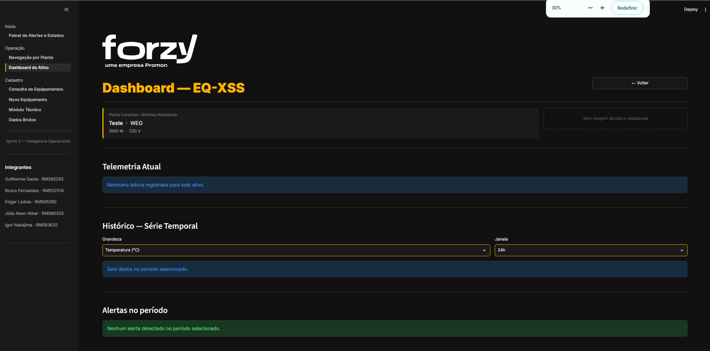 | 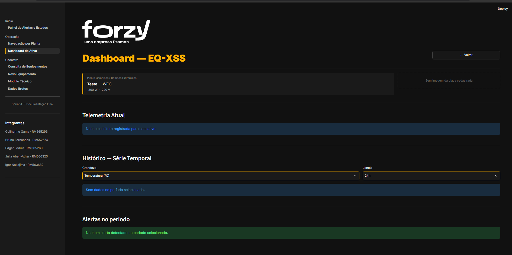 |

---

## 3. Diferenciais e Resultados da Solução

### 3.1 Diferenciais técnicos e de experiência

**Cores semânticas em toda a interface.** Verde, amarelo e vermelho têm um significado só — dentro da baseline, desvio, ação imediata — e vêm de um único dicionário de tokens (`estilos.CORES`, `COR_BORDA_STATUS`). A mesma cor aparece no KPI, na borda do card, no badge, na faixa do gauge, na banda da série temporal e na coluna Status da consulta. O operador aprende o código uma vez.

**Componentização.** Toda peça visual repetida é uma função que devolve HTML a partir de dados: `html_card_alerta`, `html_card_recomendacao`, `html_kpi`, `html_painel_resumo`, `html_badge`, `html_card_equipamento`, `html_header_ativo`. As páginas só montam layout. Foi essa organização que permitiu corrigir a injeção de HTML (item 2.3a) em dois arquivos, sem tocar em nenhuma página.

**Desacoplamento entre tela, análise e IA.** A página nunca chama o detector nem a LLM. O fluxo é:

```text
 telemetria.py  (limite fixo) ─┐
                               ├─► resumos.py ─► eventos.py ─► painel_alertas.py
 analitico.py   (detecção ML) ─┘     (NLP)        (SQLite)      (só lê eventos)
```

`pipeline_alertas.executar_ciclo()` grava eventos; o painel lê eventos. Trocar o previsor pela LSTM, o Gemini por outro modelo, ou a interface Streamlit por outro cliente não exige mexer nas outras camadas — a API da seção 5 é a prova: reaproveita `app/services/` sem reescrever regra.

**Detecção que pega o que a regra fixa não pega.** Três detectores complementares, cada um cobrindo um modo de falha:

| Detector | Pega | Por que os outros não pegam |
|---|---|---|
| Resíduo de previsão | Spike, travamento | — |
| CUSUM do resíduo | Deriva lenta (rolamento degradando) | O erro instantâneo é minúsculo; só o acumulado mostra o viés |
| Variância da janela | Sensor congelado, link IO-Link caído | Sinal parado é *fácil* de prever: o resíduo cai em vez de subir |

Os limiares saem da baseline de cada ativo (p99 do resíduo, múltiplo do CUSUM em operação normal), não de uma constante global.

**IA que não quebra a tela.** Os resumos usam Gemini 2.5 Flash com `response_schema` estrito e `temperature=0.2`. Sem chave, sem rede, cota estourada ou resposta inválida, o texto vem do gerador por template e o card mostra o selo `Resumo automático` em vez de `IA · Gemini`. Cache de 30 min por diagnóstico, deduplicação de eventos em 30 min e teto de 3 chamadas por ciclo mantêm o plano gratuito dentro da cota.

**Rastreabilidade.** Cada alerta é um registro na tabela `eventos` com origem (`limite` ou `ml`), score, limiar, detectores que dispararam, causa provável, texto gerado, origem do texto e se foi reconhecido. O histórico filtrável no fim do painel mostra isso; a API acrescenta `trace_id` por requisição e o feedback do operador por resumo.

### 3.2 Jornada do usuário — monitorar → receber alerta → agir

**1. Monitorar.** O painel abre direto no estado da frota: quantos ativos estão críticos, em alerta e saudáveis, quantas anomalias o modelo encontrou nas últimas 24 h, e um parágrafo escrito pela IA dizendo onde agir primeiro.

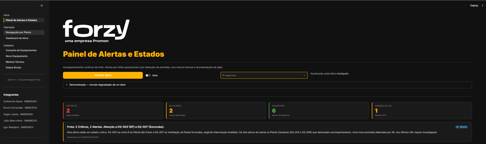

A Navegação por Planta dá a visão física: Planta → Área → cards dos ativos, já coloridos pelo status.

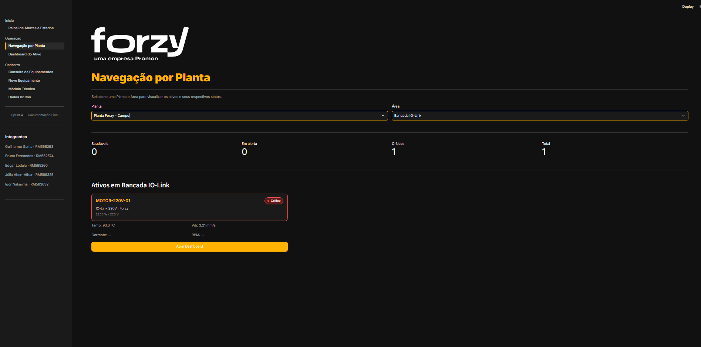

**2. Receber o alerta.** Quando um ativo sai da faixa, o card entra no topo do painel ordenado por severidade, com o título, a explicação em português, a causa provável e o valor medido. A demonstração injeta degradação real no banco pelo próprio painel.

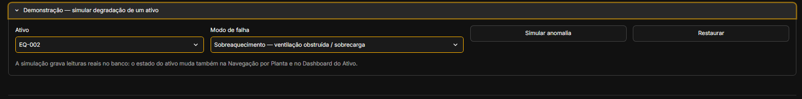

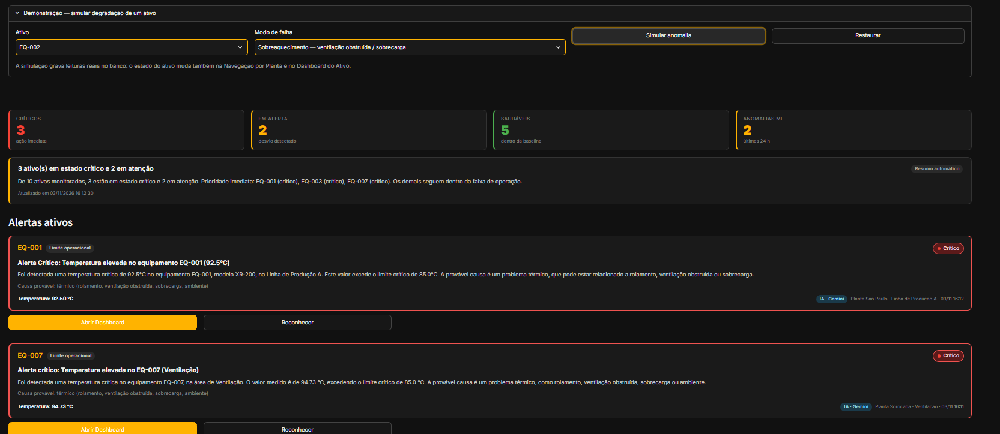

O caso que mostra o valor da camada analítica: **deriva térmica lenta** no EQ-004. A temperatura sobe a 59,8 °C — abaixo do limite de alerta de 75 °C, então a regra fixa não dispara. O CUSUM dispara, e o card sai com o selo roxo `ML · anomalia` e a barra de score contra o limiar.

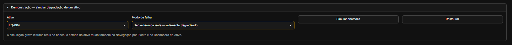

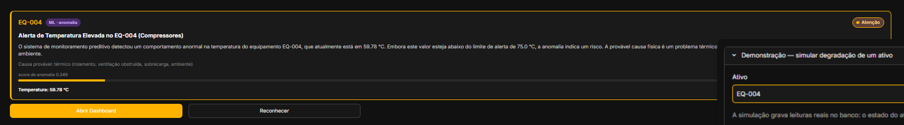

A mesma resposta, consultada pela API do protótipo, mostra qual detector disparou:

```json
{"tag": "EQ-004", "alarme": true, "severidade": "warn",
 "feature_dominante": "temperatura",
 "detectores": {"residuo": false, "cusum": true, "variancia": false},
 "pista": "térmico (rolamento, ventilação obstruída, sobrecarga, ambiente)"}
```

**3. Agir.** Abaixo dos alertas, três ações para o alerta mais severo, em ordem de execução e com a cor da urgência: imediata, neste turno, planejar.

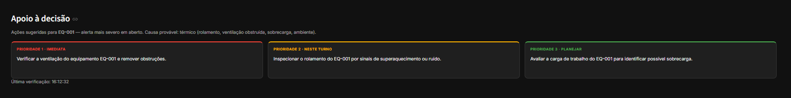

"Abrir Dashboard" leva ao ativo, com os quatro gauges e o histórico para confirmar a tendência antes de mandar a equipe.

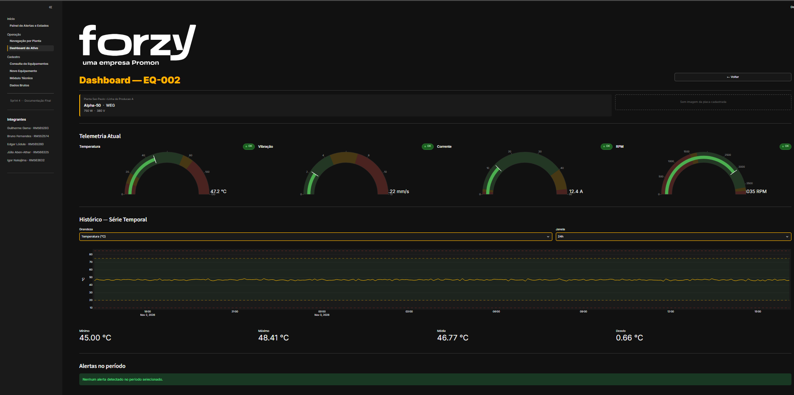

"Reconhecer" tira o alerta da lista ativa e ele permanece no histórico.

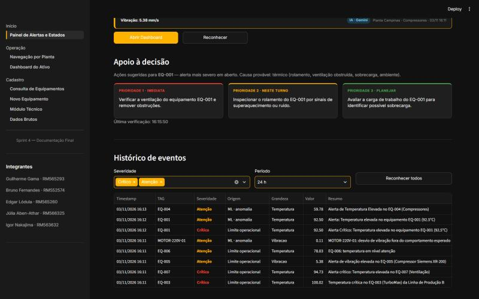

**Cadastro com IA.** Na entrada de um ativo novo, a foto da placa preenche os cinco campos. Cada campo mostra se veio da IA (✓) ou precisa ser preenchido (⚠), e todos continuam editáveis antes de salvar.

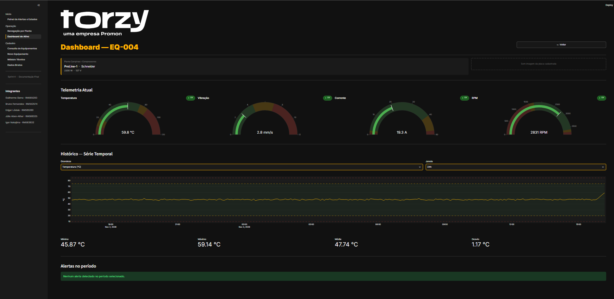

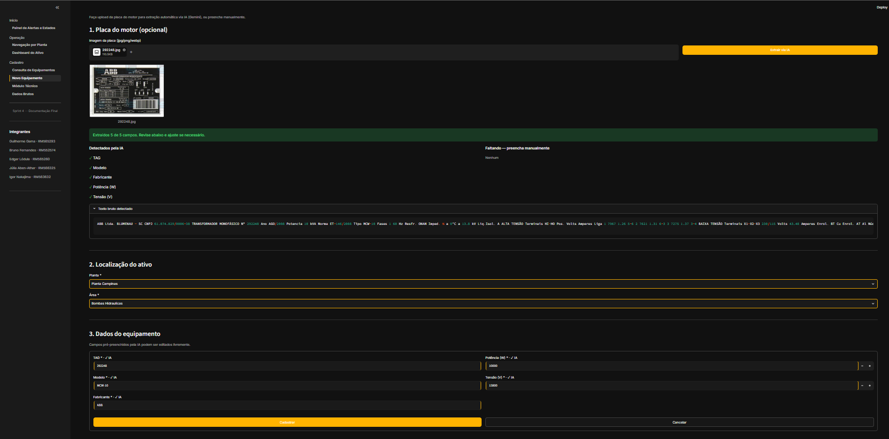

### 3.3 Como a solução atende ao Challenge Forzy

| Necessidade da Forzy | Resposta da solução |
|---|---|
| Saber o estado da frota sem abrir ativo por ativo | Painel inicial com KPIs, resumo executivo e alertas ordenados por severidade |
| Detectar degradação antes de virar falha | CUSUM pega deriva ainda dentro da faixa operacional (EQ-004, seção 3.2) |
| Entender o alerta sem ser especialista em dados | Resumo em português com causa provável e valor medido |
| Saber o que fazer | Três ações priorizadas por urgência |
| Cadastrar ativo sem digitação | OCR da placa com revisão humana |
| Usar dado real de campo | `MOTOR-220V-01` ingerido da camada Silver do Data Lake |
| Integrar com outros sistemas | Protótipo de API REST (seção 5) |

---

## 4. Pendências, Justificativas e Melhorias Futuras

### 4.1 O que ficou pendente ou parcial

| Item | Estado | Por que não foi feito |
|---|---|---|
| Previsor LSTM treinado | **Parcial.** O ponto de troca existe (`analitico._prever()`), mas o previsor em uso é uma média exponencial da janela | **Dependência de outra disciplina.** Os artefatos (`modelo_lstm.pt`, `scalers.pkl`, `metadados.json`) são produzidos no módulo de Modelagem e não foram publicados para o front. Os detectores já funcionam sobre o resíduo da média exponencial, como mostram os testes |
| Corrente e RPM do `MOTOR-220V-01` | Ausentes: gauges mostram "Sensor não instalado" | **Limitação física.** A bancada IO-Link tem só sensor de vibração e temperatura |
| RAG sobre o catálogo WEG | Não integrado. O corpus da Sprint 1 de PLN alimentou só os dados do EQ-009 | **Escopo e prazo.** Exige base vetorial e recuperação, e a prioridade foi o ciclo de alerta |
| Autenticação de usuário na interface | Inexistente | **Escopo.** Login (OIDC) exige provedor de identidade configurado, fora do alcance da disciplina; a API da seção 5 introduz API Key como primeiro passo de controle de acesso |
| Persistência multiusuário | SQLite local, um processo | **Decisão de escopo.** Adequado para demonstração; produção exige banco servidor (seção 5) |
| Cota do Gemini | O plano gratuito limita requisições diárias | **Limitação externa.** Mitigada por cache, deduplicação e fallback, sem quebrar a tela |
| Responsividade mobile | Layout pensado para desktop | **Limitação técnica.** `st.columns` não reflui bem em tela estreita; o operador de campo usa tablet ou desktop |
| Testes das páginas Streamlit | Cobertos só os serviços, componentes e API | **Complexidade.** `streamlit.testing` existe, mas não houve prazo para cobrir as sete telas |

### 4.2 Melhorias priorizadas

| Prioridade | Melhoria | Esforço | Viabilidade |
|---|---|---|---|
| P1 | Plugar a LSTM em `_prever()` assim que os artefatos forem publicados | Baixo, uma função | Alta: o contrato `Diagnostico` não muda |
| P1 | Migrar o front para consumir a API em vez de importar `app/services/` | Médio | Alta: os endpoints já existem |
| P2 | Botões 👍/👎 nos cards de alerta gravando em `POST /eventos/{id}/feedback` | Baixo | Alta: backend pronto |
| P2 | Trocar SQLite por PostgreSQL e o timer por um worker agendado | Médio | Alta |
| P3 | RAG sobre manuais e catálogos para enriquecer as recomendações | Alto | Média: depende de curadoria do corpus |
| P3 | Interface mobile dedicada para o técnico em campo | Alto | Média |

---

## 5. Ir além — Proposta de arquitetura de produção

### 5.1 Problema

Hoje a interface Streamlit **é** o backend: a página importa `app/services/` e acessa o SQLite no mesmo processo. Consequências: só um tipo de cliente; cada aba aberta roda o pipeline de alertas; não há autenticação; um erro técnico aparece cru para o operador; e não há como relacionar a queixa de um usuário com o que aconteceu no servidor.

### 5.2 Arquitetura proposta

```text
              ┌──────────────────────┐        ┌───────────────────────┐
              │  Front Streamlit     │        │  App mobile / SCADA   │
              │  (só apresentação)   │        │  outros consumidores  │
              └──────────┬───────────┘        └───────────┬───────────┘
                         │  HTTPS + X-API-Key + X-Trace-Id│
                         ▼                                ▼
              ┌──────────────────────────────────────────────────────┐
              │  API REST — FastAPI                                  │
              │  middleware: trace_id · duração · log estruturado    │
              │  handlers: erro padrão {erro, mensagem, trace_id}    │
              ├──────────────────────────────────────────────────────┤
              │  app/services/  (inalterado)                         │
              │  telemetria · analitico · resumos · eventos          │
              └───────┬─────────────────────┬────────────────┬───────┘
                      ▼                     ▼                ▼
                 PostgreSQL          Worker agendado     Gemini API
               (hoje: SQLite)    (executar_ciclo, hoje     (resumos)
                                  disparado pela tela)
```

### 5.3 Protótipo implementado

Pasta `api/`. Roda com `uvicorn api.main:app --port 8000`; documentação interativa em `/docs`.

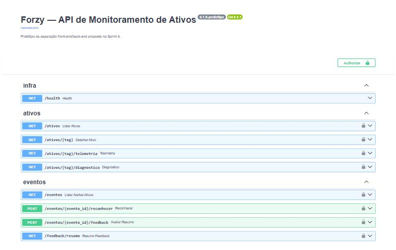

| Método | Rota | Função | Auth |
|---|---|---|---|
| GET | `/health` | Healthcheck do balanceador | pública |
| GET | `/ativos` | Lista de ativos com planta e área | API Key |
| GET | `/ativos/{tag}` | Ficha, última leitura e status por grandeza | API Key |
| GET | `/ativos/{tag}/telemetria?janela=1h\|3h\|24h\|7d` | Série histórica | API Key |
| GET | `/ativos/{tag}/diagnostico` | Os 3 detectores sobre o histórico | API Key |
| GET | `/eventos?horas=24` | Alertas ativos, mais severo primeiro | API Key |
| POST | `/eventos/{id}/reconhecer` | Reconhece um alerta | API Key |
| POST | `/eventos/{id}/feedback` | Feedback do operador sobre o resumo da IA | API Key |
| GET | `/feedback/resumo` | Taxa de aprovação por origem do texto (Gemini × template) | API Key |

**Autenticação por API Key.** Header `X-API-Key`, comparado com a variável de ambiente `FORZY_API_KEY`. Se a variável não estiver configurada a API responde 503 em tudo, porque subir aberta por esquecimento é pior do que não subir.

**Observabilidade.** O middleware aceita o `X-Trace-Id` do cliente, ou gera um, e devolve no header da resposta, no corpo de erro e em cada linha de log, junto com `X-Duracao-Ms`. Um print de erro enviado pelo operador leva direto à linha do log do servidor.

**Erros amigáveis.** Todo erro sai no mesmo formato, em português, sem stack trace:

```text
$ curl -i http://localhost:8000/ativos            # sem X-API-Key
HTTP/1.1 401 Unauthorized
x-trace-id: 66060ca09d7f4fed
{"erro":"nao_autorizado","mensagem":"Chave de API ausente ou inválida (header X-API-Key).","trace_id":"66060ca09d7f4fed"}

$ curl -H "X-API-Key: ***" http://localhost:8000/ativos/NAO-EXISTE
{"erro":"nao_encontrado","mensagem":"Ativo NAO-EXISTE não encontrado.","trace_id":"4c6e279e6d6247d8"}

$ curl -X POST ... -d "{nao e json" http://localhost:8000/eventos/1/feedback
{"erro":"dados_invalidos","mensagem":"Corpo da requisição não é um JSON válido.","trace_id":"ac3c85b219e34f94"}
```

Ao capturar estas evidências, o grupo encontrou dois casos em que o erro ainda saía no formato cru do framework (`{"detail": "There was an error parsing the body"}`). O handler estava registrado na `HTTPException` do FastAPI, mas o Starlette levanta a classe-mãe. A correção foi feita nesta sprint, com teste.

**Trace propagado pelo cliente:**

```text
$ curl -i -H "X-API-Key: ***" -H "X-Trace-Id: demo-sprint4" http://localhost:8000/ativos/EQ-004/diagnostico
HTTP/1.1 200 OK
x-trace-id: demo-sprint4
x-duracao-ms: 12
{"tag":"EQ-004","score":0.3539,"threshold":1.7317,"alarme":true,"severidade":"warn",
 "detectores":{"residuo":false,"cusum":true,"variancia":false}, ...}
```

**Feedback do usuário em respostas de IA.** Cada avaliação guarda o evento, útil sim/não, comentário e o `trace_id`. Agregado por origem do texto, permite medir se o Gemini de fato escreve melhor que o template — hoje isso é suposição.

```text
$ curl -X POST -H "X-API-Key: ***" -H "Content-Type: application/json" \
       -d '{"util": true, "comentario": "Recomendação correta"}' http://localhost:8000/eventos/6/feedback
{"evento_id":6,"registrado":true}

$ curl -H "X-API-Key: ***" http://localhost:8000/feedback/resumo
[{"origem_resumo":"gemini","avaliacoes":1,"uteis":1,"taxa_aprovacao":1.0}]
```

### 5.4 Plano de migração

| Fase | Entrega | Risco que remove |
|---|---|---|
| 0 — feito | API lendo a mesma camada de serviços, com auth, trace e erros padronizados | Prova que a separação não exige reescrever regra |
| 1 | Front passa a chamar a API via `httpx`; `pipeline_alertas.executar_ciclo()` sai da página para um worker com agendamento | Cada aba aberta deixa de rodar o pipeline |
| 2 | Remover `import streamlit` de `resumos.py`, `pipeline_alertas.py` e `gemini_client.py` (hoje usam `st.cache_data` e `st.secrets`), trocando por cache próprio e variável de ambiente | Serviços ficam independentes de framework de UI |
| 3 | SQLite → PostgreSQL; API Key por cliente com rotação | Concorrência e revogação de acesso |
| 4 | Botões de feedback nos cards; painel de qualidade da IA | Decidir com dado se o custo do Gemini se paga |

---

## 6. Conclusão

Ao longo de quatro sprints a solução saiu de um formulário de cadastro e chegou a um painel que diz ao operador qual motor está degradando, explica em português o que aconteceu e propõe a ação, inclusive para desvios que ainda estão dentro da faixa operacional e que uma regra de limite não veria.

A Sprint 4 tratou o que a entrega da Sprint 3 deixava frágil, sem acrescentar funcionalidade:

- **Escape de HTML.** Texto vindo de OCR e de LLM não vira mais marcação na tela.
- **Testes.** Os detectores, que antes eram validados no olho durante a demo, agora são verificados por 22 testes.
- **Dependências.** As versões estão fixas e o projeto instala igual em qualquer máquina.
- **Arquitetura.** A separação entre front e back foi demonstrada com um protótipo de API que reaproveita a camada de serviços sem reescrever regra.
- **Erros da API.** Dois erros do próprio protótipo apareceram durante a captura de evidências e foram corrigidos.

A pendência principal é a LSTM, que depende da disciplina de Modelagem. O código está preparado para recebê-la em uma única função. Os próximos passos mais baratos e de maior efeito são o front consumir a API e os botões de feedback nos cards.

---

## Anexo — Como executar

```bash
python -m venv .venv
.venv\Scripts\activate
pip install -r requirements-dev.txt

streamlit run main.py                       # front: http://localhost:8501
$env:FORZY_API_KEY = "<chave>"               # PowerShell
uvicorn api.main:app --port 8000             # API:   http://localhost:8000/docs
pytest                                       # 22 testes
```

A chave do Gemini (`GEMINI_API_KEY`) é opcional. Sem ela, os resumos são gerados por template. Na primeira execução, `data/forzy.db` é criado com 7 dias de histórico e o motor real é ingerido do Parquet.
